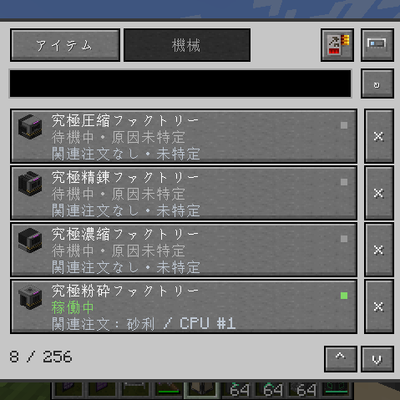

# ME Access



Access registered AE2 and Mekanism machine menus from your existing ME terminal,
with machine status and related crafting-order diagnostics. Install on both client
and server. Mekanism is optional; support does not extend to every mod or multiblock.

Previously named ME Remote Machine Terminal. The mod ID remains `me_remote_machine`
so existing cards and registrations are preserved. Remove the old JAR when updating;
do not install both names at once.

既存のAE2端末に機械アクセスカードを取り付け、登録した機械の元のGUIを開く独立アドオンです。
Forge 1.20.1 / NeoForge 1.21.1。クライアントとサーバーの両方に導入します。
Forge版のAE2依存条件は15.4.10以上・上限なしです。ビルド基準も15.4.10とし、不要なパッチ版制限を設けません。

## 使い方

1. 通常・クラフト・パターンエンコーディング端末、またはワイヤレス端末を開きます。
2. 通常端末では表示セル欄へ機械アクセスカードを1枚入れます。ワイヤレス端末では左側のカードアイコンからアップグレード枠を開きます。
3. 「機械」へ進み、登録ツールのアイコンでインベントリ内の機械登録ツールを接続します。
4. 同じMEネットワークに接続・隣接する機械をツールで右クリックします。
5. 端末の機械一覧から対象を選びます。元の機械GUIが開きます。

通常端末では既存の表示セル5枠を共用し、カードは1枚まで入れられます。残りの枠の表示セルは本来のフィルターとして動作します。
旧専用枠のカードはロード時に空いている表示セル枠へ移します。5枠が埋まっている場合は旧枠に保持し、機械一覧のカードアイコンから取り出せます。
ワイヤレス端末では既存のアップグレード枠を使います。
ワイヤレス端末の本来のリンク先・通信範囲・電力消費を維持します。
登録先はカード内に保存され、カードを別の対応端末へ移しても残ります。
登録ツールの接続先は端末とカードを識別するため、移設後は再接続してください。
「アイテム」でAE2本来のストレージ・クラフト画面へ切り替えられます。
ストレージ画面のカードアイコンから機械一覧へ戻れます。
機械GUIにも一覧へ戻るカードアイコンがあります。
登録済み機械をツールでスニーク右クリックするか、一覧の削除ボタンで登録解除します。
検索とスクロールに対応し、登録はカードごとに256件まで保存します。

## 状態・詰まり表示

Mekanism本来のレシピエラー情報を読み、出力空き不足、電力不足、低電力による低速化、
入力不足、副材料・左右入力不足、入力に対応する出力なし、レッドストーン停止を表示します。
ファクトリーは各工程のエラーを集約します。稼働中の工程と停止中の工程が混在すれば両方表示します。
さらに、未ロード、別ディメンション、撤去・置換、アクセス拒否、ME接続切れを区別します。
AE2機械は取得できる稼働状態を表示します。特定できない状態は「待機中・原因未特定」とし、
正常とも、入力不足とも断定しません。独自レシピエラーは個別対応が必要です。

機械の搬出面が未設定の場合も表示します。出力が残っていて自動搬出がOFFなら、外部回収は可能な設定として区別します。
隣接してこの機械を向く同一MEネットワークのパターンプロバイダーについて、材料の未搬入、MEへの返却待ち、
レッドストーンロック、成果物待ち、電力・チャンネル未確立、機械側のアイテム入力面無効を表示します。
画面表示中に実際のAE2送出が拒否された場合は、その直近40tickの観測も表示します。
実際の送出時に、接続面の搬入先不在、ブロッキングモードによる材料残留待ち、搬入先による入力拒否を区別します。
拒否は機械に面する方向ごとに記録し、別方向の機械の原因と混同しません。入力拒否だけでは空き不足と入力種類不一致を断定しません。
一覧の各行に関連する注文対象とCPUを表示し、複数候補はツールチップに併記します。
標準AE2 CPUは稼働中ジョブのパターン集合も読み、中間工程から親注文を関連付けます。独自CPUは公開ジョブ情報で注文対象を照合し、非公開の中間工程は推測しません。
関連注文は、その機械への専属割り当ての証明ではありません。数量はAE2のlong表示から推測せず、注文名・CPU・取得できた注文IDで識別します。
Mekanism本来の稼働フラグが立っていれば主表示は「稼働中」です。並行工程の警告はツールチップに残します。
「機械の出力枠が不足」はレシピ出力バッファの問題です。「搬出先の収納が満杯」は、出力面の先にある対応バニラ収納の全枠が満杯と確認できた場合だけ表示します。
後者は単独チェスト・樽・シュルカーボックスが対象です。パイプ・合体チェスト・任意MODの収納や未ロード先について満杯とは断定しません。
診断用に発注・再送・レシピ計算・アイテム移動は行いません。パターンの存在だけでは注文の実行中とは判定しません。
パイプの先や別ネットワークのプロバイダー、化学物質専用の搬入面、任意MODの回収経路までは追跡しません。

状態の取得は機械一覧で表示中の最大9件だけ、20tick間隔です。閉じている一覧の常時監視、
全ワールド探索、レシピの再計算は行いません。原因表示から元のGUIを開き、
手動で取り出しや設定変更ができます。自動廃棄・強制搬出・処理の代行はしません。

## 対応範囲

- AE2: インスクライバー、分子組立機。
- Mekanism: 通常のTileEntityMekanism系単体機械GUI。独自マルチブロックは対象外。
- 同じディメンションの、サーバー側で既にロードされている機械。
- 別MODのGUIはアダプター単位で追加できます。Mekanism対応は全MOD対応を意味しません。

遠方の機械をクライアントが読み込んでいなくても、GUI専用の非稼働ミラーを用意します。
ワールドに仮の機械を設置せず、チャンクを強制ロードせず、アイテムの転送処理も置き換えません。
インベントリ、同期、機械の設定操作は元のメニュー経路を使用します。
Mekanismの所有者・セキュリティ設定を維持し、端末の電力・チャンネル・機械へのME接続・アクセス権限を再確認します。
機械が破壊・アンロードされたり、カードを外したり、接続・権限を失うと遠隔アクセスを終了します。
通常端末から離れた場合、ワイヤレス端末が範囲外・電力切れになった場合も終了します。
独自保護MODの遠隔アクセス規則は別途連携が必要な場合があります。

## ビルド

```powershell
.\gradlew.bat :forge:build :neoforge:build
```

Java 17と21を用意してください。Mekanismは任意依存です。
開発クライアントにMekanismを読み込ませる場合は`-PwithMekanism`を付けます。
配布JARは各ローダーの`build/libs/`に出力されます。

オリジナルコードはLGPL-3.0-only。AE2とMekanismは別プロジェクトであり、それぞれのライセンスが適用されます。
アイテム表示はインストール済みAE2のテクスチャを参照します。AE2のテクスチャファイルは同梱しません。
ロゴは作者提供のゲーム画面です。画面内のAE2・Mekanism等の意匠は各プロジェクトに帰属します。

## Project License

Original project code and resources: `LGPL-3.0-only`. See [LICENSE](LICENSE)
and [LICENSING.md](LICENSING.md). Third-party material retains its own terms.
